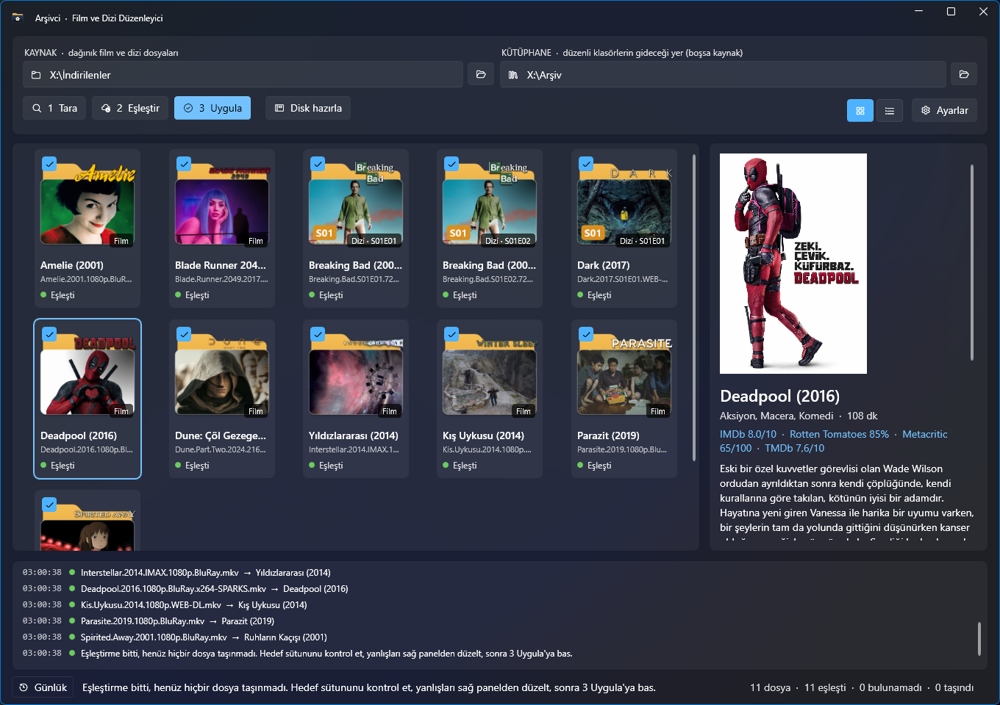

# Arşivci

[Türkçe](README.md) · **English**

**A Windows app that turns scattered movie and TV files into a tidy archive with poster folder icons.**

Arşivci ("archivist") recognizes files like `Deadpool.2016.1080p.BluRay.x264-SPARKS.mkv` and looks them up on TMDb, OMDb and Fanart.tv. It then:

- moves the file into a `Deadpool (2016)` folder
- turns the film's artwork into an icon for that folder
- writes genre, cast, ratings, audio and subtitle languages and more into `Bilgi.txt` ("info")

**[⬇ Download the latest release](https://github.com/MihrimatriX/archive-archiver/releases/latest)**: no installer, a single `.exe`, no .NET install needed.

> The app's interface is in Turkish. This README names its buttons in Turkish, with the English meaning in brackets. Movie and show details can be fetched in Turkish or English.



## Before / after

```
E:\Downloads\
├── Deadpool.2016.1080p.BluRay.x264-SPARKS.mkv
├── Deadpool.2016.1080p.BluRay.x264-SPARKS.tr.srt
├── Breaking.Bad.S01E01.720p.HDTV.mkv
└── Breaking.Bad.S01E02.720p.HDTV.mkv
```

```
E:\Archive\
├── _arsivci_kayit.txt
├── Deadpool (2016)\
│   ├── Deadpool.2016.1080p.BluRay.x264-SPARKS.mkv
│   ├── Deadpool.2016.1080p.BluRay.x264-SPARKS.tr.srt
│   └── Bilgi.txt
└── Breaking Bad (2008)\
    ├── Bilgi.txt
    └── Season 01\
        ├── Breaking.Bad.S01E01.720p.HDTV.mkv
        ├── Breaking.Bad.S01E02.720p.HDTV.mkv
        └── Bilgi.txt
```

Each folder also gets hidden `folder.ico`, `folder.jpg`, `fanart.jpg`, `logo.png` and `desktop.ini` files. They make Explorer show the folder with its poster icon, and show the plot summary when you hover over it.

## Features

- **Understands release names.** Strips tags like `1080p`, `BluRay`, `x265`, `WEB-DL` and `TR Dublaj`, and extracts the year and the `S01E02` / `1x02` episode number. If a file is just `S01E01.mkv`, the show name comes from the parent folder (`Breaking Bad\Season 1\`).
- **Picks the right match.** Weighs title similarity, year and popularity, so a `12 Monkeys` file matches the 1995 film rather than a 2026 short. If a match is wrong, search for the right one in the side panel; for a show, the fix applies to every episode.
- **Preview first.** Nothing moves until you press *Uygula* (Apply).
  - The **grid** view shows each file with the folder icon it will get.
  - The **list** view shows each file's full target path.
- **Log.** The bottom panel lists every step and the result for each file (what it matched, where it moved, which error occurred), color-coded. The *Günlük* (Log) button in the status bar shows or hides it.
- **Safe with your files.**
  - Never overwrites a file.
  - Logs every move to `_arsivci_kayit.txt`.
  - Moves across drives copy first, so the source survives an interrupted move.
- **Keeps file names.** Only the folder is decided; the video keeps its own name. Subtitles named after the video (`.srt`, `.ass`, `.sub/.idx`, `.vtt`…) move with it.
- **Readable folder names.** The original title is used when it is in Latin script (`Le Fabuleux Destin d'Amélie Poulain`); otherwise the English title, so a Korean or Hindi title stays readable.
- **Poster folder icons.** The film's wide backdrop is on the front panel. The logo sits right-aligned and sticks out over the folder's top edge; without a logo, the title is written instead. Season folders also get an `S01` badge.
- **Bilgi.txt** contains:
  - original title, genre, runtime, director, cast
  - IMDb / Rotten Tomatoes / Metacritic / TMDb ratings, awards, plot
  - per video: resolution, codec, HDR, audio languages and channels, embedded and external subtitles (via MediaInfo)
- **Disc prep.** Prepares a folder for burning to CD/DVD/Blu-ray (details below).

## Usage

1. **Download and run.** The exe is unsigned, so Windows may show "Windows protected your PC": click **More info → Run anyway**.
2. Enter your API keys under **Ayarlar** (Settings). See the table below.
3. Choose your folders:
   - **Kaynak** (Source): the folder with the scattered files.
   - **Kütüphane** (Library): where the organized archive should go. If left empty, the source folder is organized in place.
4. **1 Tara** (Scan) finds the videos. Hidden/system files and `sample` files under 300 MB are skipped.
5. **2 Eşleştir** (Match) fetches the details and shows the folder icons on the cards.
   - Select a wrongly matched file and fix it in the side panel.
   - Untick the files you don't want moved.
   - Switch to the **list** view (top right) to see the target paths.
6. **3 Uygula** (Apply) asks for confirmation, then moves the files, downloads the artwork and creates the icons and `Bilgi.txt`.

## API keys

All three keys are free. At least **TMDb** or **OMDb** is required; all three together give the best results.

| Service | Provides | Key |
|---|---|---|
| [TMDb](https://www.themoviedb.org/settings/api) | Search, localized title and plot, poster, backdrop, logo, cast | v3 API key or v4 read access token; both work |
| [OMDb](https://www.omdbapi.com/apikey.aspx) | IMDb, Rotten Tomatoes, Metacritic ratings, awards | Sent by email; it only works after you click the activation link in that email |
| [Fanart.tv](https://fanart.tv/get-an-api-key/) | HD logos, high-resolution posters, season posters, disc art | Optional |

With **Bilgi dili** (Info language) set to *Türkçe*, titles without a Turkish plot summary fall back to the English one. Settings are stored as plain text in `%APPDATA%\ArchiveArchiver\settings.json`.

## Disc prep

When you pick a folder with **Disk hazırla** (Prepare disc), Arşivci:

- adds `autorun.inf` and a disc icon
- if the folder has a single video, sets the disc to play it when inserted; with more than one, a poster menu (`menu.hta`) opens instead
- tells you which disc the total size fits on: CD, DVD, DVD DL, BD-25 or BD-50

Burn the folder's **contents**, not the folder itself, to the root of the disc.

## Notes

- **Folders show as "read-only".** Windows only shows a custom folder icon when this flag is set. The files inside are not affected.
- **To undo:** each line of `_arsivci_kayit.txt` holds `date ⇥ from ⇥ to`.
- **Only one window at a time.** Two windows could share the settings and try to move the same files.

## Building from source

Requires the [.NET 10 SDK](https://dotnet.microsoft.com/download).

```powershell
dotnet publish -c Release -o publish
```

This produces `publish\ArchiveArchiver.exe`, a single file with .NET, WPF and MediaInfo inside.

### Self-test

```powershell
# name parsing and matching tests (exit code 0 = passed)
(Start-Process .\publish\ArchiveArchiver.exe '--selftest' -Wait -PassThru).ExitCode

# + move, icon, Bilgi.txt and disc tests; runs in a temp folder, no network
(Start-Process .\publish\ArchiveArchiver.exe '--selftest','C:\path\sample.mp4' -Wait -PassThru).ExitCode
```

### Releasing

```powershell
git tag v1.2.0
git push origin v1.2.0
```

The [release workflow](.github/workflows/release.yml) builds the exe, runs the self-test, creates the release and attaches `Arsivci-1.2.0-win-x64.exe`. Every push to `main` runs the same build and test; the exe is kept as an artifact on the Actions page.

## Built with

[WPF-UI](https://github.com/lepoco/wpfui) · [MediaInfo](https://mediaarea.net/MediaInfo) · [TMDb](https://www.themoviedb.org) · [OMDb](https://www.omdbapi.com) · [Fanart.tv](https://fanart.tv)

<sub>This product uses the TMDB API but is not endorsed or certified by TMDB.</sub>
